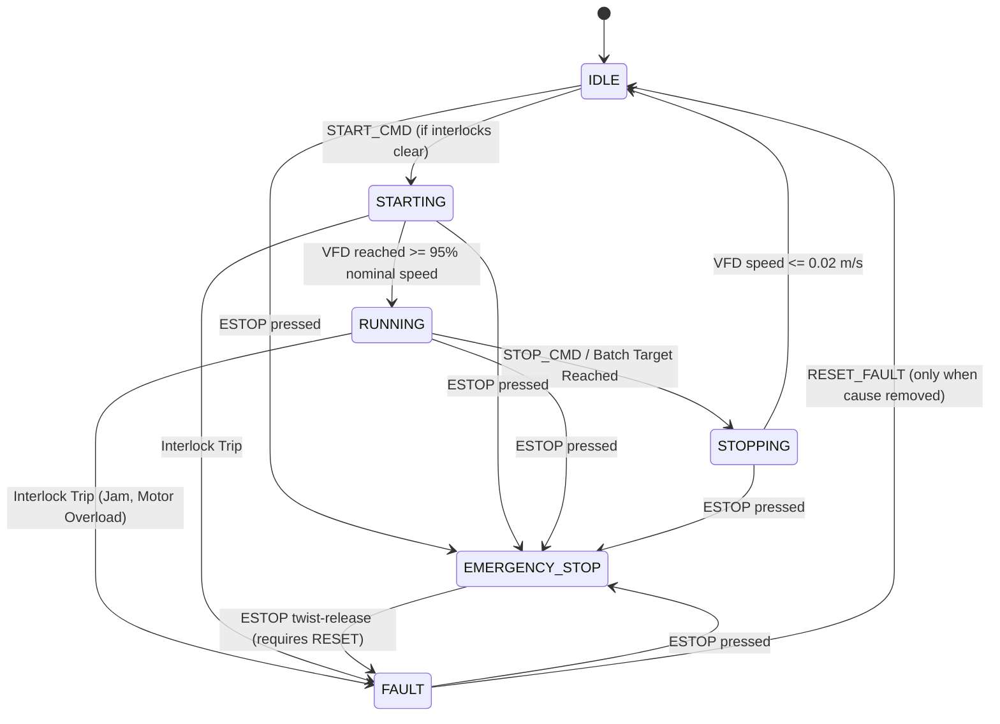

# Functional Design Specification (FDS)
## SCADA-Based Automated Conveyor Belt Monitoring and Bottle Sorting System

**Document ID:** FDS-SCADA-BTL-001  
**Revision:** 1.2  
**System:** Browser-Based Educational SCADA & Industrial Conveyor Simulator  
**Classification:** Technical Specification  
**Status:** Released  

---

## 1. System Overview & Purpose

The **SCADA-Based Automated Conveyor Belt Monitoring and Bottle Sorting System** is an educational industrial control simulator developed to model a continuous-motion bottle packaging line. The system demonstrates core supervisory control, data acquisition, and automated material handling principles commonly found in food, beverage, and pharmaceutical manufacturing facilities.

The simulator models bottles introduced at an infeed zone, transported along a variable-frequency driven conveyor belt, optically inspected for classification and physical defects, and automatically sorted into designated accumulation bins or a defect reject lane.

```
       [ 1. Infeed ] ---> [ 2. Inspection S-01 ] ---> [ 3. Reject Gate ] ---> [ 4. Diverter Arm ] ---> [ 5. Discharge ]
                                (x = 350)                 (x = 500)                (x = 640)               (x = 950)
                                                               │                        │                       │
                                                               ▼                        ▼                       ▼
                                                         [ Reject Bin ]            [ Bin B ]               [ Bin A ]
                                                           (Defects)             (1000ml Amber)          (500ml Clear)
```

> **Honesty Notice:** This software is a browser-based SCADA simulator developed with React, TypeScript, and Tailwind CSS. It is inspired by industrial control room environments (Wonderware InTouch, Ignition SCADA, Siemens WinCC). All hardware signals, PLC scan cycles, and process variables are **SIMULATED** client-side. No physical PLC connection is implied.

---

## 2. Process Description & Material Handling

### 2.1 Product Categories & Specifications
The line classifies two valid container formats and rejects out-of-spec defective containers:

| Container Format | Nominal Volume | Material & Color | Dimensions | Target Lane |
|---|---|---|---|---|
| **Category A** | 500 mL | Clear PET | Standard height (100%), Narrow body | **Bin A** (Straight Discharge) |
| **Category B** | 1000 mL | Amber PET | Tall height (110%), Wide body | **Bin B** (Pneumatically Diverted) |
| **Defective Bottle** | Any | Any (Underfill, Missing Cap, Deformed) | Non-compliant | **Reject Bin** (Defect Ejector) |

### 2.2 Quality Inspection & Defect Handling
At position $x = 350$ (Photoelectric Sensor S-01), the container is inspected:
- **Underfilled:** Fill level $< 70\%$ of nominal volume.
- **Missing Cap:** Optical verification fails to detect closure presence.
- **Deformed:** Structural bottle neck angle deviation.
- **Unverified:** Generated when optical sensor is flagged in a malfunctioning or dirty state.

Defective containers are rejected at position $x = 500$ by a high-speed pneumatic ejector into the dedicated **Reject Bin**. Defect probability is operator-configurable from $0\%$ to $20\%$ (default $5\%$).

### 2.3 Sorting & Destination Routing
1. **Defect Rejection ($x = 500$):** If defect status $\neq \text{NONE}$, the bottle is sorted into the Reject Bin and `REJECT_COUNT` increments.
2. **Category B Diversion ($x = 640$):** If category is Category B and mode is `AUTO`, the 5/2 pneumatic diverter arm extends (`%QX0.1`), guiding the container down chute B into **Bin B**.
3. **Category A Packaging ($x = 920$):** Remaining defect-free Category A containers travel straight through the discharge end into **Bin A**.

### 2.4 Mathematical Consistency Invariant
At all points in execution, total infeed is rigorously conserved:
$$\text{Total Infeed} = \text{Bin A Count} + \text{Bin B Count} + \text{Reject Count} + \text{Bottles Currently on Belt}$$

---

## 3. Inputs and Outputs (I/O Image Table)

The system maps field elements to standardized IEC 61131-3 simulated addresses.

### 3.1 Digital Inputs (%IX)
| Address | Tag Name | Physical Device | Description |
|---|---|---|---|
| `%IX0.0` | `ESTOP_PB_NC` | Pushbutton (NC) | Mushroom Emergency Stop safety circuit contact |
| `%IX0.1` | `SENSOR_01_DETECT` | Optical Retroreflective | Bottle presence detection beam at station 2 |
| `%IX0.2` | `START_PB_NO` | Pushbutton (NO) | Operator line start command button |
| `%IX0.3` | `STOP_PB_NC` | Pushbutton (NC) | Operator line normal stop command button |
| `%IX0.4` | `FAULT_RESET_PB` | Pushbutton (NO) | Interlock reset command after fault clearance |
| `%IX0.5` | `ALARM_ACK_PB` | Pushbutton (NO) | Horn silence / alarm acknowledge sign-off |
| `%IX0.6` | `JAM_SENSOR_TRIP` | Optical Timer Relay | Beam blockage exceeding jam timeout ($\ge 3.0\text{ s}$) |

### 3.2 Digital Outputs (%QX)
| Address | Tag Name | Actuator / Indicator | Description |
|---|---|---|---|
| `%QX0.0` | `CONV_MOTOR_RUN` | Contactor Coil | Conveyor drive motor main contactor coil |
| `%QX0.1` | `DIVERTER_01_CMD` | 5/2 Solenoid Valve | Pneumatic diverter arm extend/retract cylinder |
| `%QX0.2` | `REJECT_01_CMD` | Pneumatic Ejector | Defective container discard ejector cylinder |
| `%QX0.3` | `STATUS_LAMP_RUN` | Green Pilot Lamp | Steady on when conveyor is in `RUNNING` state |
| `%QX0.4` | `STATUS_LAMP_WARN` | Amber Pilot Lamp | Steady on during `STARTING`, `STOPPING`, or warnings |
| `%QX0.5` | `STATUS_LAMP_FAULT`| Red Pilot Lamp | Flashing on `FAULT` or steady on `EMERGENCY_STOP` |
| `%QX0.6` | `AUDIBLE_SIREN_CMD`| 24V Electronic Horn | Active on unacknowledged alarms (`ACTIVE_UNACK`) |

### 3.3 Analog & Register Tags (%MW / %MD)
| Address | Tag Name | Data Type | Engineering Units | Description |
|---|---|---|---|---|
| `%MW100` | `CONV_STATE_ENUM` | `STRING` | — | Current machine state machine enumeration |
| `%MD102` | `CONV_SPEED_SP` | `REAL` | m/s | Commanded VFD conveyor linear speed setpoint |
| `%MD106` | `CONV_SPEED_PV` | `REAL` | m/s | Tachometer process variable feedback speed |
| `%MD110` | `CONV_VFD_FREQ` | `REAL` | Hz | Inverter electrical drive output frequency |
| `%MW114` | `CONV_MOTOR_RPM` | `INT` | RPM | 4-Pole induction motor rotor velocity |
| `%MD116` | `MOTOR_TEMP_PV` | `REAL` | °C | Stator winding PT100 temperature sensor |
| `%MD120` | `MOTOR_LOAD_PCT` | `REAL` | % | Motor shaft mechanical torque load percentage |
| `%MD124` | `MOTOR_CURRENT_A` | `REAL` | A | Motor phase RMS current draw |
| `%MD130` | `SENSOR_01_TOTAL` | `INT` | Units | Total beam break counter at inspection zone |
| `%MD134` | `DIVERTER_STROKES` | `INT` | Cycles | Cumulative mechanical cycle counter |
| `%MW140` | `COUNT_CAT_A` | `INT` | Units | Category A (500 mL Clear) cumulative pack count |
| `%MW142` | `COUNT_CAT_B` | `INT` | Units | Category B (1000 mL Amber) cumulative pack count |
| `%MW148` | `REJECT_COUNT` | `INT` | Units | Defective bottle quality reject accumulator |
| `%MW150` | `BATCH_TARGET` | `INT` | Units | Batch target quantity setpoint ($0 = \text{continuous}$) |
| `%MD152` | `BATCH_PROGRESS` | `REAL` | % | Real-time batch completion percentage |

---

## 4. Machine Operating States

The system implements a deterministic, safety-prioritized finite state machine:



1. **IDLE:** Conveyor stopped, motor contactor open. Ready to receive start command.
2. **STARTING:** VFD ramps frequency ($0 \rightarrow 50\text{ Hz}$) and linear velocity ($0 \rightarrow 1.0\text{ m/s}$).
3. **RUNNING:** Nominal speed reached. Bottle infeed, optical inspection, sorting, and telemetry logging active.
4. **STOPPING:** Normal deceleration ramp. Controlled stop either initiated by operator `STOP` button or automatically triggered when the configured `BATCH_TARGET` is satisfied.
5. **FAULT:** Protective safety trip caused by conveyor jam, thermal motor overload, or persistent backlog. Motor power immediately removed.
6. **EMERGENCY_STOP:** Hard safety circuit opening (`%IX0.0`). Highest priority state. All motion halted instantly, siren armed.

---

## 5. Fault Detection & Alarm Interlocks

### 5.1 Fault Matrix
| Code | Condition | Detection Logic | Automated System Response | Recovery Procedure |
|---|---|---|---|---|
| **ALM-100** | Emergency Stop | `%IX0.0` Open | Immediate transition to `EMERGENCY_STOP`; de-energize contactor | Twist-release E-stop, press `FAULT_RESET`, then `START` |
| **ALM-101** | Conveyor Jam | Sensor blocked continuous $\ge 3.0\text{ s}$ | Transition to `FAULT`; stop VFD; sound alarm | Clear physical blockage, press `FAULT_RESET`, then `START` |
| **ALM-102** | Motor Thermal Overload | PT100 temperature $\ge 80^\circ\text{C}$ or current $\ge 15\text{ A}$ | Transition to `FAULT`; run cooling fan; disable restart | Allow stator to cool below threshold, press `FAULT_RESET` |
| **ALM-201** | Sensor Malfunction | Flagged dirty or beam failure | Warning logged; bottles flagged `UNVERIFIED`; sent to reject bin | Clean optical lenses, clear fault flag |
| **ALM-202** | Buffer Backlog | Belt bottle buffer $> 18$ units | Speed automatically governed; warning annunciated | Drain accumulator buffer downstream |

---

## 6. References & Inspiration

This Functional Design Specification incorporates best practices in industrial machine control inspired by the following physical automation implementations:

1. **Automated-Conveyor-Sorting-System** by *Noah Antonio* (CODESYS + Factory I/O): Inspiration for multi-lane product classification, retroreflective optical coordination, and IEC register naming conventions.
2. **Industrial-Bottle-Packaging-Line** by *Aditya Katariya* (Allen-Bradley MicroLogix 1100 + RSLogix 500 + AVEVA Edge): Inspiration for bottle packaging sequence documentation, dedicated defect reject station architecture, and formal FDS layout.
3. **Smart-Conveyor-System** by *Paresh Metaliya* (Siemens S7-1200 + TIA Portal + Factory I/O): Inspiration for jam timeout detection logic, batch target control, and process statistical data blocks.

*Notice: No ladder logic, proprietary code, graphics, or vendor libraries were copied. All simulator logic, algorithms, and documentation were independently designed and developed.*
